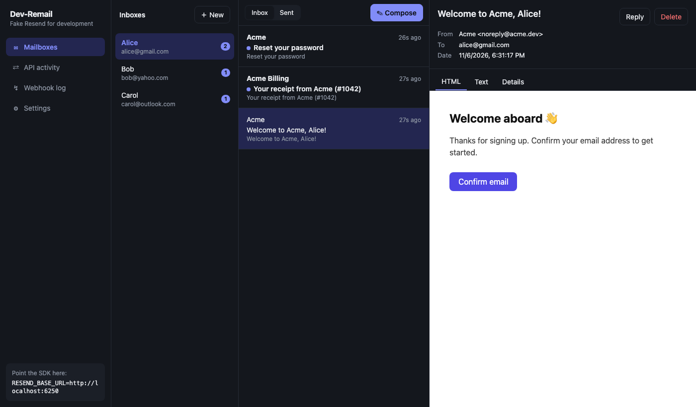
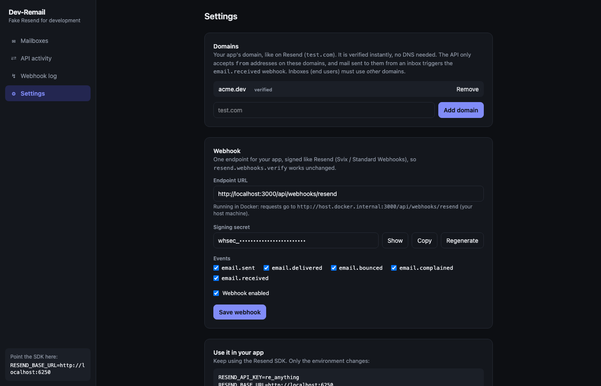

<div align="center">

# Dev-Remail

**A local, Resend-compatible mail sandbox for development.**

Point the official Resend SDK at it, see every email in a mailbox UI, and get signed webhooks in your app. No API keys, no real emails.

[](LICENSE)

</div>



> Unofficial project, not affiliated with or endorsed by Resend. "Resend" is a trademark of its owner and is used here only to describe API compatibility.

## Why

Every developer on a team that uses [Resend](https://resend.com) needs their own API key just to test or continue development, and a typo can email real users. Dev-Remail is a drop-in replacement for the Resend API that runs on your machine or a shared dev server. Nothing leaves it.

## Features

- **Drop-in compatible**: works with the official Resend SDK. Only an environment variable changes.
- **Mailbox UI**: browse mail per inbox with HTML, text and details views, attachments, reply and compose. No login.
- **Multi-user testing**: create as many fake end-user inboxes as you like (`alice@gmail.com`, `bob@yahoo.com`).
- **Inbound email**: send mail from an inbox to your app's domain to trigger the `email.received` webhook.
- **Signed webhooks**: `email.sent`, `email.delivered`, `email.bounced`, `email.complained` and `email.received`, verified by `resend.webhooks.verify()`. Includes retries, a delivery log and re-send.
- **Bounce simulation**: use `bounced@resend.dev` or `complained@resend.dev` as recipients.
- **Single container**: Next.js and SQLite, with data kept in a volume.



## Quick start

```bash
docker run -p 127.0.0.1:6245:6245 -v dev-remail-data:/data abdullahqasim01/dev-remail
```

or from source with Docker Compose:

```bash
git clone https://github.com/abdullahqasim01/dev-remail.git && cd dev-remail
docker compose up --build
```

Open **http://localhost:6245**, then:

1. **Settings → Domains**: add your app's sending domain, e.g. `test.com`. It's verified instantly and needs no DNS.
2. **Settings → Webhook**: set your app's webhook URL and copy the signing secret into your app's env.
3. **Mailboxes → New**: create inboxes for your fake users. Use other domains such as `gmail.com`. Inboxes can't use a registered app domain.

## Use it in your app

No code changes, only environment variables:

```bash
RESEND_API_KEY=re_anything                 # any value is accepted
RESEND_BASE_URL=http://localhost:6245      # read by the official Node SDK
```

or in code: `new Resend(key, { baseUrl: "http://localhost:6245" })`. Other Resend SDKs have an equivalent base-URL option. Keep your real key and no base URL in production.

Webhook verification stays the same as with Resend:

```ts
const event = resend.webhooks.verify({
  payload: rawBody,
  headers: { id: req.headers["svix-id"], timestamp: req.headers["svix-timestamp"], signature: req.headers["svix-signature"] },
  webhookSecret: process.env.RESEND_WEBHOOK_SECRET!,
});
```

Inside Docker, webhook URLs using `localhost` are routed to your host machine automatically.

## How mail flows

| Action | Result | Webhooks |
|---|---|---|
| Your app sends to `alice@gmail.com` through the SDK | Appears in Alice's inbox and in **API activity** | `email.sent`, then `email.delivered` |
| Your app sends to an address with no inbox | Recorded in **API activity**, marked delivered | same |
| Your app sends to `bounced@resend.dev` or `complained@resend.dev` | Simulated outcome (a `+label` suffix is fine) | `email.sent`, then `email.bounced` or `email.complained` |
| Alice composes to `support@test.com` (a registered domain) | Stored as received mail | `email.received` |
| Alice composes to Bob (both inboxes) | Appears in Bob's inbox | none |

Failed webhook deliveries are retried after 2s, 10s and 30s. Inspect payloads and re-send from **Webhook log**.

## API compatibility

Request and response shapes and error formats match the official Node SDK (`resend@6.x`), and every endpoint below is covered by tests run with the real SDK.

| Area | Endpoints |
|---|---|
| Sending | `POST /emails`, `GET /emails`, `GET /emails/:id`, `GET /emails/:id/attachments[/:id]`, `Idempotency-Key` support |
| Batch | `POST /emails/batch` (`x-batch-validation: strict \| permissive`) |
| Receiving | `GET /emails/receiving[/:id]`, `.../attachments[/:id]`, raw `.eml` download used by `emails.receiving.forward()` |
| Domains | `POST /domains`, `GET /domains`, `GET\|PATCH\|DELETE /domains/:id`, `POST /domains/:id/verify` |

**Not supported:** scheduled sends (`scheduled_at` is accepted but the email is delivered immediately), templates, audiences, contacts, broadcasts, API-key management, and Resend's webhook management API (configure the webhook in the UI instead).

## Security

Dev-Remail is a development tool and has **no authentication**: anyone who can reach the port can read all mail and change the webhook URL. The server also makes outgoing requests to the webhook URL and to attachment `path` URLs you send. Keep it on localhost or a trusted network, and don't expose it to the internet. The provided Docker setup binds to `127.0.0.1` for this reason; publish the port more widely only when you mean to.

## Configuration

| Variable | Default | Description |
|---|---|---|
| `PORT` | `6245` | Listen port |
| `DATABASE_URL` | `file:./data/dev-remail.db` (`file:/data/dev-remail.db` in Docker) | SQLite file |
| `WEBHOOK_SECRET` | generated on first start | Fixed signing secret (`whsec_…`) |
| `PUBLIC_URL` | derived from the request | Base of attachment and raw-email download URLs |

## Development

Requires Node.js 22+.

```bash
npm install
npm run dev        # generates the Prisma client, applies migrations, starts on http://localhost:6245
npm run lint
npm run typecheck
npm run build && npm test     # integration tests, run with the official Resend SDK
```

The tests boot the production build on a free port with a throwaway SQLite database, so they never touch your real data.

**Stack:** Next.js (App Router; route handlers serve the Resend API) · Prisma 7 with SQLite (better-sqlite3 adapter) · Tailwind CSS.

**Layout**

```
src/app/emails, src/app/domains   Resend-compatible API routes
src/app/api/ui                    internal API used by the UI
src/app/page.tsx, activity/,      UI pages: mailbox, API activity,
  webhooks/, settings/            webhook log, settings
src/lib                           mail service, webhooks, validation, serializers
prisma/                           schema and SQL migrations
scripts/migrate.mjs               migration runner (also used by the Docker entrypoint)
```

**Changing the schema:** edit `prisma/schema.prisma`, then add a new `prisma/migrations/NNNN_name/migration.sql`. Generate the SQL with `npx prisma migrate diff --from-schema <old> --to-schema prisma/schema.prisma --script`. Migrations run automatically at start.

## Contributing

Issues and pull requests are welcome. Before opening a PR, run `npm run lint`, `npm run typecheck` and `npm run build && npm test`; CI runs the same checks. For API changes, please check behaviour against the official Resend SDK.

## Releasing (maintainers)

Pushing a tag that starts with `v` runs `.github/workflows/publish.yml`. It checks types and lint, then builds a multi-arch (amd64 + arm64) image and pushes it to Docker Hub. Set the repository secrets `DOCKERHUB_USERNAME` and `DOCKERHUB_TOKEN` once, then:

```bash
git tag v0.1.0 && git push origin v0.1.0     # publishes :0.1.0, :0.1 and :latest
```

To publish by hand: `DOCKER_USER=<user> npm run docker:publish`.

## License

[MIT](LICENSE) © Abdullah Qasim
